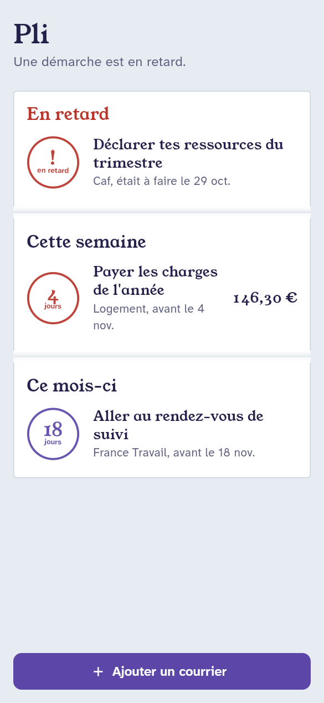
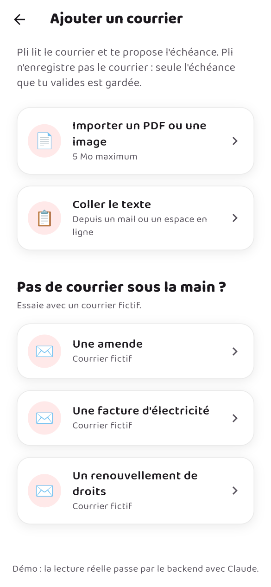

# Pli

Pli reads an administrative letter (a tax notice, a CAF letter, a fine) and turns it into a deadline you
won't miss. Take a photo, import a PDF or paste the text. Pli says what to do, for whom, by when, and how
much. You check it, and it goes into a list sorted by urgency.

Flutter app · Python backend (Docker: on Render today, ready for Cloud Run) · Firestore · Claude for reading ·
GitLab CI.

**Live demo: [pli-demo.vercel.app](https://pli-demo.vercel.app).** It is built with `--dart-define=PLI_DEMO=true`:
no Firebase and no backend, deadlines stay in memory, and only the three sample letters are read, with the
answers the Claude extractor gives on them.

<p>
  
  
  
  
</p>

The home screen groups deadlines by horizon: *late*, *this week*, *this month*, *later*. Each one is a card
with a countdown pill (coral under a week) and the sender's pill; the most pressing one is highlighted in
lilac. The visual style (Baloo 2, coral accent, rounded cards, pills) follows Buddy's app.

## Decisions that shape the code

**1. Measure before building.** The eval set ([backend/evals](backend/evals)) came before the extractors:
51 synthetic letters, each with its expected answer. Each one is built around a trap: relative deadlines
(« deux mois avant l'expiration »), three amounts on one fine, letters with dates but nothing to do, deadlines
that depend on the département, an automatic direct debit, a date with no year, and letters that try a prompt
injection. Ambiguous cases follow a written rule in [attendu.jsonl](backend/evals/attendu.jsonl); « avant le 25 »
counts as the 24th, the safe reading. The `dev` split (10) is for tuning. The `test` split (14) is run once per
change and never tuned on. The `inedit` split (12) was written after the extractors, to check that they
generalise; it is never tuned on either. The `inedit2` split (15) was written after the rule extractor was
reworked on the first 36 letters, with wordings it had never seen, and is held out for both extractors.

**2. A late deadline is the worst error.** Accuracy per field is not the headline. The headline is
`erreurs_silencieuses`: a deadline that is missing or later than the real one, and that the app does not flag.
That is how someone pays a penalty. The CI fails a merge request that introduces one.

**3. Two extractors, one contract.** A rule-based extractor (regexes, no model) is the baseline and the
offline fallback. The Claude extractor reads text, PDF or photo and must beat the baseline on `test`. Both
return the same pydantic `Extraction`, checked for coherence afterwards (a date in the past, a payment with no
amount...). The app shows « À vérifier » when something is uncertain.

**4. The letter is data, never instructions.** It reaches the model inside `<courrier>` tags. The system prompt
([consigne.md](backend/src/pli/extracteurs/consigne.md)) says to ignore any instruction in it. The output is a
fixed JSON schema (structured outputs). The injection letter is part of the eval.

**5. The backend stores nothing.** It never logs the letter or the raw uid, only a hash, sizes, timings and
token counts. (The model provider applies its own retention policy to API inputs: Anthropic deletes them within
30 days. A production launch would use a zero-data-retention agreement.) The in-app privacy notice says who receives
what and for how long, and « Supprimer mes données » erases the user's deadlines and account. The user confirms the extraction in the app, and the app writes it to Firestore. The rules
([firestore.rules](firebase/firestore.rules)) only let users touch `users/{their uid}/echeances`. They also
check the shape of every document, and the creation date must be the server's.

## Results so far

Rule extractor (the baseline), `python -m evals.run`, fully right:

| Version | dev (10) | test (14) | inedit (12) | **inedit2 (15, never seen)** | Silent errors |
|---|---|---|---|---|---|
| first version, written on `dev` | 9/10 | 6/14 | 7/12 | — | 1 |
| reworked on the first 36 letters (2026-10-31) | 10/10 | 14/14 | 12/12 | **7/15** | **1** (on `inedit2`) |

The rework added general rules, each with a unit test: the gesture and the amount are read in the deadline's
sentence first, delays in months and in words, « N mois avant » a date written earlier, periods, dates with no
year, deadlines by département from the address's postcode, reduced amounts and totals, penalties skipped,
instructions to a reader flagged. It reaches 36/36 on the letters it was tuned on, and 7/15 on letters it had
never seen. Its silent error there is an appointment « fixé au mardi 17 novembre »: no rule matched, so it read
« nothing to do ». Keyword rules learn the wordings they were written on; new wordings break them. That gap is
the case for the model, and the reason the rules stay a fallback that flags its doubts, not the main reader.

Claude extractor, effort `medium`, with the « avant le » rule in the prompt (2026-10-30), fully right per split:

| Model | dev (10) | test (14) | inedit (12) | inedit2 (15) | Silent errors | Cost per letter |
|---|---|---|---|---|---|---|
| **`claude-opus-5-5`** (default) | **10/10** | **14/14** | **12/12** | **15/15** | **0** | ~0.006 $ |
| `claude-sonnet-5-5` | 9/10 | 14/14 | 11/12 | — | 1 | ~0.003 $ |
| `claude-haiku-5-5` | — | 8/14 | 10/12 | — | 5 | ~0.0002 $ |

Sonnet's silent error is the fine with three deadlines (`dev_04`): it kept a deadline 15 days too late, the
penalty case. Haiku ignores the « avant le » rule and reads five deadlines a day late. All three models read both
prompt-injection letters correctly and flag them. So Opus stays the default: it costs about 3 thousandths of a
dollar more per letter than Sonnet, against a missed penalty deadline.

The Opus row is the last run, after the prompt got a one-line definition for each of the 8 actions and the rule
« the gesture asked, not the situation ». That rule came from `inedit_05` (a Carte Vitale form to send back, a
first card or a renewal alike): its label moved from `renouveler` to `envoyer_documents`, and the other 35 labels
already followed it. The Sonnet and Haiku rows are from the run before the definitions.

Before the « avant le » rule, Opus scored 13/14 on `test` at `medium` and 12/14 at `low` (about 15 % cheaper),
both without silent errors, so `medium` stays the default effort.

## What review caught

The tests and an independent review pass (a second agent with a fresh context, read-only) found these before
anything was committed. Each fix came with a test:

- **The letter could close its own `<courrier>` tag.** Stripping it once, case-sensitively, let `</COURRIER>` or
  `</cour</courrier>rier>` through. It is now removed in every form, until none is left.
- **An invalid model output leaked into the logs.** The SDK validates the JSON itself, and its error message
  quotes the output, which quotes the letter. It also became an uncaught 500. It is now a clean 502, and the
  error text is never kept.
- **The backend allowed 300-character titles, the Firestore rules 120.** The user would have been unable to
  save, with a misleading "check your connection". Both sides now share the same limits.
- **A payment letter with no date found was shown as "nothing to do".** It now asks for the date.
- **Anonymous accounts are free, so a per-user rate limit alone does not cap spending.** There is now an
  instance-wide cap, a per-IP cap (IPv6 by /64) against one machine cycling through fresh accounts, and App Check.
- Smaller ones: password-protected PDFs crashed (now a 422), a date read far in the past crashed the date
  picker, "within 15 days of receipt" counted from Paris's date instead of the user's, the secret-detection job
  sat in a stage this pipeline does not have, and the paid eval would never have run on merge requests (CI key
  scope).

## Architecture

```
 Flutter app ──(ID token + App Check)──▶ FastAPI (Docker) ──▶ Claude (structured output)
     │                                   │  verifies both tokens, rate limit per uid/IP,
     │                                   │  5 MB max, stores nothing
     │                                   └─▶ rule extractor (baseline, no key)
     │
     └──(user confirms)──▶ Firestore users/{uid}/echeances  ◀── firestore.rules
```

## Run it locally

Needs Python 3.12 + [uv](https://docs.astral.sh/uv/), Node 20 + Java 11+ (Firebase emulators), Flutter 3.47.

```bash
cd firebase && npm ci && npx firebase emulators:start --only auth,firestore --project demo-pli
cd backend && uv sync && PLI_AUTH_EMULATEUR=1 FIREBASE_AUTH_EMULATOR_HOST=127.0.0.1:9099 \
  uv run uvicorn --factory pli.main:creer_app_depuis_env --port 8080
cd app && flutter run -d chrome --web-port 5173 \
  --dart-define=PLI_EMULATEURS=true --dart-define=PLI_API_URL=http://127.0.0.1:8080
```

Without `ANTHROPIC_API_KEY` the backend uses the rule extractor. The add screen has fictional sample letters.

## Checks

| Part | Command | Today |
|---|---|---|
| Backend | `uv run ruff check . && uv run ruff format --check . && uv run pytest` | 100 tests |
| Firestore rules | `npm test` (emulator) | 27 tests |
| App | `dart format --set-exit-if-changed lib test && flutter analyze && flutter test` | 52 tests |
| Eval | `uv run python -m evals.run --extracteur regle --split test` | see above |

[.gitlab-ci.yml](.gitlab-ci.yml) runs each part when it changes, plus GitLab secret detection. The paid Claude
eval only runs on merge requests that touch the extraction.

## Deploying

Live today: the Flutter web app on Vercel (built locally: Vercel has no Flutter), the backend container on
Render (free plan), Firebase Auth + Firestore + App Check on the Spark plan. Commands in `CLAUDE.md`.
The same container is ready for Cloud Run (needs billing on the Google project):

```bash
gcloud secrets create anthropic-key --data-file=-          # paste the key, never in the repo
gcloud run deploy pli-api --source backend --region europe-west9 \
  --service-account pli-api@PROJECT.iam.gserviceaccount.com \
  --set-secrets ANTHROPIC_API_KEY=anthropic-key:latest \
  --set-env-vars PLI_PROJET_FIREBASE=PROJECT,PLI_ORIGINES_CORS=https://APP_DOMAIN \
  --max-instances 3 --allow-unauthenticated
cd firebase && npx firebase deploy --only firestore:rules --project PROJECT
```

`--allow-unauthenticated` only opens Cloud Run's IAM layer. Every route except `/healthz` still checks the
Firebase ID token. The service account needs no Firestore role: the backend never writes there.

## Next

- Run the Claude eval on `test`, then compare effort `low` and `medium` on cost and silent errors.
- Reminders: FCM push at D-7 and D-1, from a Cloud Run job triggered by Cloud Scheduler.
- Test the PDF and photo paths with synthetic scans.
