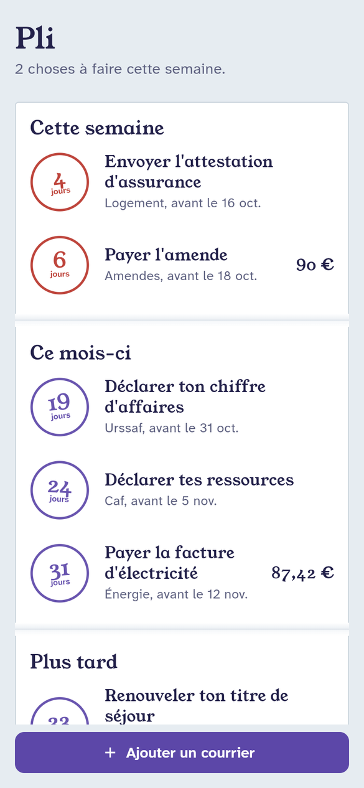
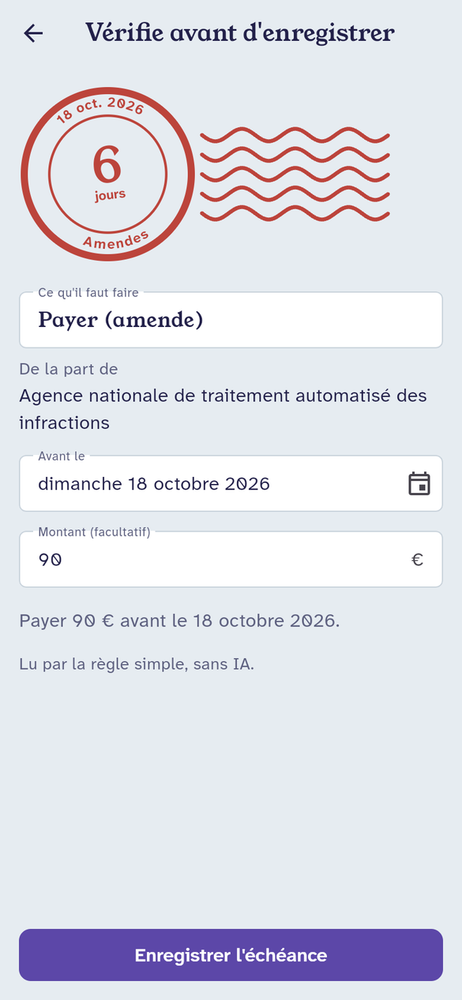
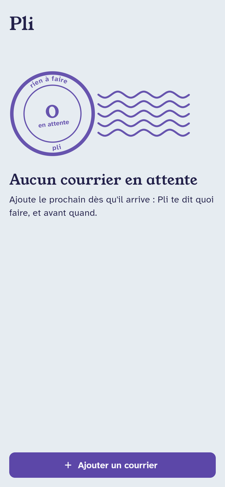

# Pli

Pli reads an administrative letter (a tax notice, a CAF letter, a fine) and turns it into a deadline you
won't miss. Take a photo, import a PDF or paste the text. Pli says what to do, for whom, by when, and how
much. You check it, and it goes into a list sorted by urgency.

Flutter app · Python backend on Cloud Run · Firestore · Claude for reading · GitLab CI.

<p>
  
  
  
</p>

The home screen is a letter folded in three: *this week*, *this month*, *later*. Each deadline gets a
postmark that counts down the days. It turns sealing-wax red under a week.

## Decisions that shape the code

**1. Measure before building.** The eval set ([backend/evals](backend/evals)) came before the extractors:
24 synthetic letters, each with its expected answer. Each one is built around a trap: relative deadlines
(« deux mois avant l'expiration »), three amounts on one fine, letters with dates but nothing to do, deadlines
that depend on the département, and a letter that tries a prompt injection. Ambiguous cases follow a written
rule in [attendu.jsonl](backend/evals/attendu.jsonl). The `dev` split (10) is for tuning. The `test` split (14)
is run once per change and never tuned on.

**2. A late deadline is the worst error.** Accuracy per field is not the headline. The headline is
`erreurs_silencieuses`: a deadline that is missing or later than the real one, and that the app does not flag.
That is how someone pays a penalty. The CI fails a merge request that introduces one.

**3. Two extractors, one contract.** A rule-based extractor (regexes, no model) is the baseline and the
offline fallback. The Claude extractor reads text, PDF or photo and must beat the baseline on `test`. Both
return the same pydantic `Extraction`, checked for coherence afterwards (a date in the past, a payment with no
amount...). The app shows « À vérifier » when something is uncertain.

**4. The letter is data, never instructions.** It reaches the model inside `<courrier>` tags. The system prompt
([consigne.md](backend/src/pli/extracteurs/consigne.md)) says to ignore any instruction in it. The output is a
fixed JSON schema (structured outputs). The injection letter is part of the eval.

**5. The backend stores nothing.** It never logs the letter or the raw uid, only a hash, sizes, timings and
token counts. (The model provider applies its own retention policy to API inputs. A production launch would use
a zero-data-retention agreement, and the privacy notice would say so.) The user confirms the extraction in the app, and the app writes it to Firestore. The rules
([firestore.rules](firebase/firestore.rules)) only let users touch `users/{their uid}/echeances`. They also
check the shape of every document, and the creation date must be the server's.

## Results so far

Rule extractor (the baseline), `python -m evals.run`:

| Split | Fully right | Date | Amount | Action | Silent errors |
|---|---|---|---|---|---|
| dev (10, tuned on) | 9/10 | 9/10 | 10/10 | 10/10 | 0 |
| **test (14, held out)** | **6/14** | 9/14 | 10/14 | 11/14 | **1** |

The gap between the two splits is overfitting, and it is the point of keeping `test` aside. The silent error is
an Urssaf reminder the rules read as « nothing to do ». Without the eval, that one would have gone unnoticed.

The Claude extractor has not been run on the eval yet (it needs an API key, about 14 calls). It is next, with
the effort level (`low` vs `medium`) as the first thing to compare.

## What review caught

The tests and an independent review pass (a second agent with a fresh context, read-only) found these before
anything was committed. Each fix came with a test:

- **The letter could close its own `<courrier>` tag.** Stripping it once, case-sensitively, let `</COURRIER>` or
  `</cour</courrier>rier>` through. It is now removed in every form, until none is left.
- **An invalid model output leaked into the logs.** The SDK validates the JSON itself, and its error message
  quotes the output, which quotes the letter. It also became an uncaught 500. It is now a clean 502, and the
  error text is never kept.
- **The backend allowed 300-character titles, the Firestore rules 120.** The user would have been unable to
  save, with a misleading "check your connection". Both sides now share the same limits.
- **A payment letter with no date found was shown as "nothing to do".** It now asks for the date.
- **Anonymous accounts are free, so a per-user rate limit alone does not cap spending.** There is now an
  instance-wide cap too. App Check is required before a public launch.
- Smaller ones: password-protected PDFs crashed (now a 422), a date read far in the past crashed the date
  picker, "within 15 days of receipt" counted from Paris's date instead of the user's, the secret-detection job
  sat in a stage this pipeline does not have, and the paid eval would never have run on merge requests (CI key
  scope).

## Architecture

```
 Flutter app ──(Firebase ID token)──▶ Cloud Run: FastAPI ──▶ Claude (structured output)
     │                                   │  verifies token, rate limit per uid,
     │                                   │  5 MB max, stores nothing
     │                                   └─▶ rule extractor (baseline, no key)
     │
     └──(user confirms)──▶ Firestore users/{uid}/echeances  ◀── firestore.rules
```

## Run it locally

Needs Python 3.12 + [uv](https://docs.astral.sh/uv/), Node 20 + Java 11+ (Firebase emulators), Flutter 3.47.

```bash
cd firebase && npm ci && npx firebase emulators:start --only auth,firestore --project demo-pli
cd backend && uv sync && PLI_AUTH_EMULATEUR=1 FIREBASE_AUTH_EMULATOR_HOST=127.0.0.1:9099 \
  uv run uvicorn --factory pli.main:creer_app_depuis_env --port 8080
cd app && flutter run -d chrome --web-port 5173 \
  --dart-define=PLI_EMULATEURS=true --dart-define=PLI_API_URL=http://127.0.0.1:8080
```

Without `ANTHROPIC_API_KEY` the backend uses the rule extractor. The add screen has fictional sample letters.

## Checks

| Part | Command | Today |
|---|---|---|
| Backend | `uv run ruff check . && uv run ruff format --check . && uv run pytest` | 62 tests |
| Firestore rules | `npm test` (emulator) | 27 tests |
| App | `dart format --set-exit-if-changed lib test && flutter analyze && flutter test` | 27 tests |
| Eval | `uv run python -m evals.run --extracteur regle --split test` | see above |

[.gitlab-ci.yml](.gitlab-ci.yml) runs each part when it changes, plus GitLab secret detection. The paid Claude
eval only runs on merge requests that touch the extraction.

## Deploying (not done yet)

```bash
gcloud secrets create anthropic-key --data-file=-          # paste the key, never in the repo
gcloud run deploy pli-api --source backend --region europe-west9 \
  --service-account pli-api@PROJECT.iam.gserviceaccount.com \
  --set-secrets ANTHROPIC_API_KEY=anthropic-key:latest \
  --set-env-vars PLI_PROJET_FIREBASE=PROJECT,PLI_ORIGINES_CORS=https://APP_DOMAIN \
  --max-instances 3 --allow-unauthenticated
cd firebase && npx firebase deploy --only firestore:rules --project PROJECT
```

`--allow-unauthenticated` only opens Cloud Run's IAM layer. Every route except `/healthz` still checks the
Firebase ID token. The service account needs no Firestore role: the backend never writes there.

## Next

- Run the Claude eval on `test`, then compare effort `low` and `medium` on cost and silent errors.
- Reminders: FCM push at D-7 and D-1, from a Cloud Run job triggered by Cloud Scheduler.
- Test the PDF and photo paths with synthetic scans.
